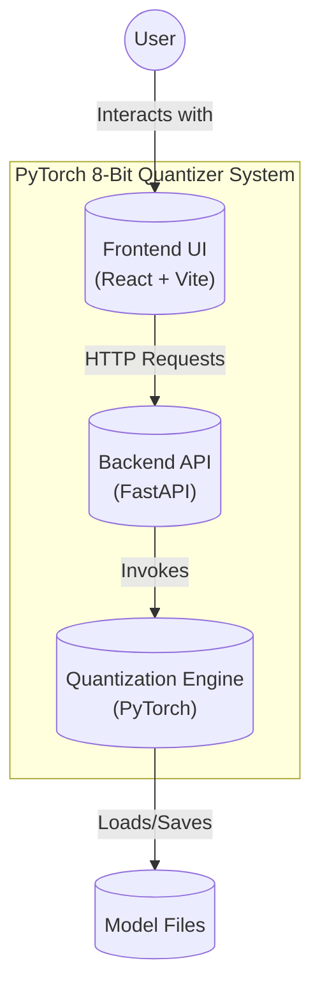
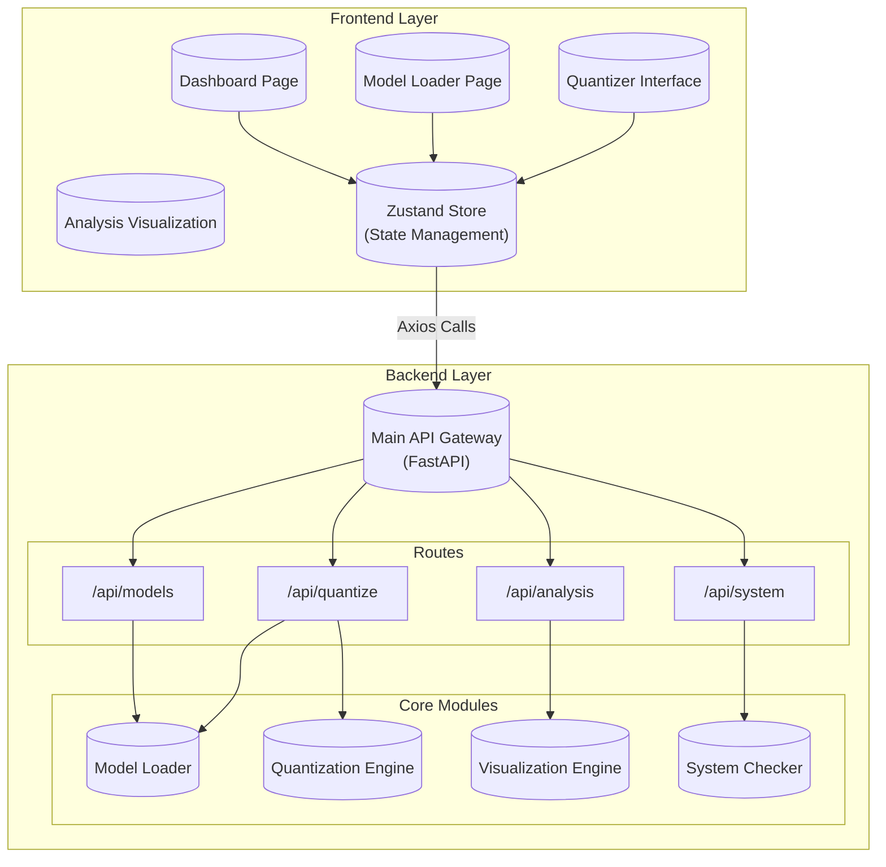
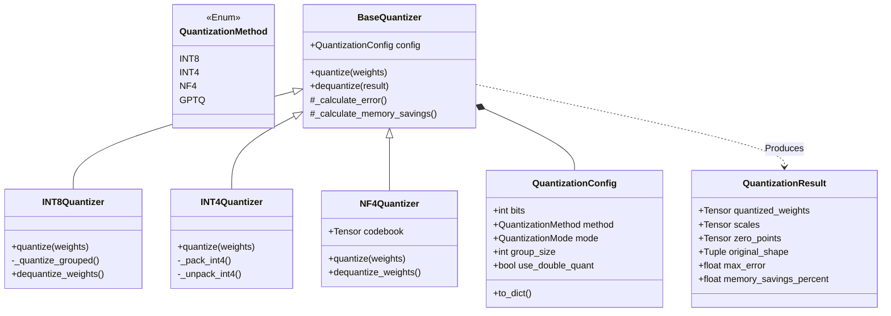

# System Architecture

## Overview
The **PyTorch 8-Bit Weight Quantizer** is a full-stack application designed to analyze, quantize, and visualize neural network weights. It consists of a **FastAPI** backend that handles the heavy lifting of PyTorch model manipulation and quantization, and a **React** frontend that provides an interactive dashboard for users.

## High-Level Architecture (C4 Context)



## Detailed Component Architecture (C4 Container)



## Quantization Core Class Diagram

The core logic resides in the `backend/core/quantizer.py` module, which implements a flexible strategy pattern for different quantization methods.



## Quantization Workflow

Sequence of events when a user triggers quantization:

```mermaid
sequenceDiagram
    participant U as User
    participant FE as Frontend
    participant API as Backend API
    participant Q as Quantizer Engine
    
    U->>FE: Select Parameters (Method, Bits, Group Size)
    U->>FE: Click "Quantize"
    FE->>API: POST /api/quantize/run (config)
    
    activate API
    API->>Q: Initialize Quantizer(config)
    API->>Q: ModelLoader.load_layer(layer_name)
    
    activate Q
    Q->>Q: Calculate Scales (Max/AbsMax)
    
    alt Grouped Quantization
        Q->>Q: Reshape to (Groups, GroupSize)
        Q->>Q: Calculate Scale per Group
    end
    
    Q->>Q: Round(Weights / Scales)
    Q->>Q: Clamp to Range (e.g. -128, 127)
    
    if INT4 or NF4
        Q->>Q: Pack 4-bit values into INT8
    end
    
    Q->>Q: Dequantize (Recover FP32)
    Q->>Q: Calculate Error (MSE, L1)
    Q-->>API: Return QuantizationResult
    deactivate Q
    
    API-->>FE: Return Result + Metrics
    deactivate API
    
    FE->>U: Display Error Heatmap & Memory Savings
    FE->>U: Show Before/After Weight Distribution
```

## Tech Stack

| Component | Technology | Description |
|-----------|------------|-------------|
| **Frontend** | React 19 | UI Library |
| | Vite | Build Tool & Dev Server |
| | Zustand | State Management |
| | Recharts | Data Visualization (Charts) |
| | Tailwind CSS | Utility-first CSS Framework (inferred) |
| **Backend** | Python 3.10+ | Core Language |
| | FastAPI | Web Framework |
| | PyTorch | Deep Learning Framework |
| | NumPy | Numerical Computing |
| | Uvicorn | ASGI Server |
